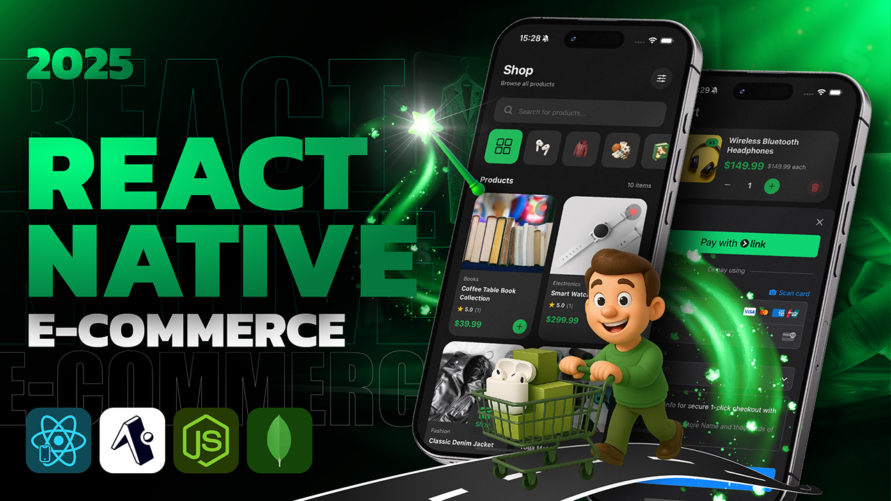

<h1 align="center">✨ AfriCart — Full-Stack E-Commerce (Mobile + Admin + API) ✨</h1>



✨ **Highlights:**

- 📱 AfriCart mobile storefront (React Native + Expo)
- 🔐 Clerk email/password and social sign-in for customers; custom password login for the admin dashboard
- 🛒 Cart, Favorites, Checkout & Orders Flow
- 💳 PesaPal API checkout with IPN-based payment confirmation
- 🗺️ Addresses System
- 🏪 Admin Dashboard — Products, Orders, Customers & Stats
- ⚙️ Complete REST API (Node.js + Express) with Auth & Roles
- 🛂 Admin-Only Protected Routes
- 📦 Background Jobs with Inngest
- 🧭 Dashboard with Live Analytics
- 🛠️ Product Management (CRUD, image handling, pricing, etc.)
- 📦 Order Management
- 👥 Customer Management Page
- 🛡️ Sentry Integration for monitoring & error tracking
- 🚀 Deployable on Vercel (API + Admin Dashboard)
- 🖼️ Product Image Slider
- ⚡ Data Fetching & Caching with TanStack Query
- 🧰 End-to-End Git & GitHub Workflow (branches, commits, PRs, code reviews)
- 🤖 CodeRabbit PR Analysis (security, quality, optimization)

---

### Automated PesaPal checkout

Checkout uses the authenticated user's server-side cart and product prices. The backend computes
the total in cents, creates a pending order, and submits that exact amount to PesaPal. AfriCart
marks it paid, decrements stock, and clears the cart only after independently checking the
transaction status, merchant reference, currency, and amount with PesaPal. The browser return page
is for the customer; the public IPN endpoint is what allows confirmation even if the customer
closes the page.

Add these values to `backend/.env` only; never put the consumer secret in the mobile app:

```bash
PESAPAL_ENV=sandbox
PESAPAL_CONSUMER_KEY=<YOUR_PESAPAL_CONSUMER_KEY>
PESAPAL_CONSUMER_SECRET=<YOUR_PESAPAL_CONSUMER_SECRET>
PESAPAL_CURRENCY=USD
PESAPAL_IPN_URL=https://<public-backend-domain>/api/payment/pesapal/ipn
PESAPAL_IPN_ID=<REGISTERED_IPN_ID>
PESAPAL_CALLBACK_URL=https://<public-backend-domain>/api/payment/pesapal/callback
```

Deploy the backend with a public HTTPS URL before registering the IPN. PesaPal calls the backend
callback URL, which verifies the transaction and then redirects the customer to the storefront's
`/payment/callback` screen. The public IPN endpoint confirms payments even when customers close the
browser. Run `npm run pesapal:register-ipn` from `backend/`; it registers the IPN and saves the
returned ID directly to `backend/.env` without printing it. Use PesaPal sandbox credentials for
testing and switch to live credentials only when ready for real charges. The backend uses MongoDB
transactions for idempotent payment, stock, and cart updates, so the database must support
transactions (MongoDB Atlas does). Set `MOBILE_CLIENT_URL` to the customer-facing mobile web
origin so its API requests pass CORS and payment callbacks can return to the storefront.

For a Vercel-hosted backend, add the same `PESAPAL_*` values to the Vercel project's server-side
environment settings and redeploy; local `backend/.env` values do not automatically reach Vercel.
Never add consumer credentials to `EXPO_PUBLIC_*` variables.

### Admin password login

The admin dashboard uses its own password login, separate from Clerk customer accounts. Passwords
of **at least 5 characters** are accepted. Generate the stored hash and a session secret from
`backend/`:

```bash
npm run admin:credentials
```

The command prompts for the password without echoing it and prints `ADMIN_PASSWORD_HASH` and
`ADMIN_SESSION_SECRET`. Add both to `backend/.env` (or the backend Vercel project), set
`ADMIN_EMAIL` to the same address, and restart/redeploy the backend. This address no longer needs a
Clerk account. Never commit the generated values. Rotating the session secret signs out existing
admin sessions.

### Customer accounts

Customers sign up and sign in on the storefront with the Clerk Core 3 Expo SDK (`@clerk/expo`),
using the same `EXPO_PUBLIC_CLERK_PUBLISHABLE_KEY` already listed for the mobile app. The web
sign-in screen supports email/password accounts plus any social providers enabled in the Clerk
Dashboard. In the Clerk Dashboard:

- Enable **Email address** and **Password** under **User & authentication → Sign-in & sign-up
  options** so customers can register without a social account.
- Add the deployed storefront origin and its `/payment/callback` route to the allowed origins and
  redirect URLs for the Clerk application.
- Review **Protect → Block sign-ups by country** if that paid protection is enabled on your Clerk
  instance; it is separate from the SMS country list and is off by default.
- The `communication.blocked_country_codes` setting is an **SMS delivery** blocklist. It does not
  block email/password registration, but allow your customer countries under **User & authentication
  → Phone** if you enable phone OTP.
- For native apps, enable the Native API and register the iOS bundle ID and Android package under
  **Native applications**.

Never use the admin credentials for customer accounts.

---

## 🧪 `.env` Setup

### 🟦 Backend (`/backend`)

```bash
NODE_ENV=development
PORT=3000

DB_URL=<YOUR_DB_URL>

CLERK_SECRET_KEY=<YOUR_CLERK_SECRET_KEY>

INNGEST_SIGNING_KEY=<YOUR_INNGEST_SIGNING_KEY>

CLOUDINARY_API_KEY=<YOUR_CLOUDINARY_API_KEY>
CLOUDINARY_API_SECRET=<YOUR_CLOUDINARY_API_SECRET>
CLOUDINARY_CLOUD_NAME=<YOUR_CLOUDINARY_CLOUD_NAME>

ADMIN_EMAIL=<YOUR_ADMIN_EMAIL>
ADMIN_PASSWORD_HASH=<SCRYPT_HASH_FROM_ADMIN_CREDENTIALS_SCRIPT>
ADMIN_SESSION_SECRET=<RANDOM_SECRET_FROM_ADMIN_CREDENTIALS_SCRIPT>

CLIENT_URL=http://localhost:5173
MOBILE_CLIENT_URL=https://<public-mobile-web-domain>

# PesaPal API checkout (credentials stay on the backend)
PESAPAL_ENV=sandbox
PESAPAL_CONSUMER_KEY=<YOUR_PESAPAL_CONSUMER_KEY>
PESAPAL_CONSUMER_SECRET=<YOUR_PESAPAL_CONSUMER_SECRET>
PESAPAL_CURRENCY=USD
PESAPAL_IPN_URL=https://<public-backend-domain>/api/payment/pesapal/ipn
PESAPAL_IPN_ID=<REGISTERED_IPN_ID>
PESAPAL_CALLBACK_URL=https://<public-backend-domain>/api/payment/pesapal/callback
```

---

### 🟩 Admin Dashboard (/admin)

```bash
VITE_API_URL=http://localhost:3000/api

VITE_SENTRY_DSN=<YOUR_SENTRY_DSN>
```

---

### 🟧 Mobile App (/mobile)

```bash
EXPO_PUBLIC_CLERK_PUBLISHABLE_KEY=<YOUR_CLERK_PUBLISHABLE_KEY>
EXPO_PUBLIC_API_URL=https://<public-backend-domain>/api

# Optional
EXPO_PUBLIC_SENTRY_DSN=<YOUR_SENTRY_DSN>
```

For local development, use a backend URL reachable from the device (for example
`http://10.0.2.2:3000/api` on the Android emulator); a physical phone needs your computer's LAN IP
or a deployed HTTPS backend.

## 🚀 Deploy on Vercel

Deploy the backend, admin, and mobile web app as **three separate Vercel projects** from this
repository. The backend is an Express app (`backend/src/server.js`); the admin is a Vite
single-page app; the mobile web app is exported as static files by Expo.

### Backend API project

1. Import the repository as a new Vercel project.
2. Set **Root Directory** to `backend` and leave the Framework Preset on **Express** (auto-detected).
3. Use `npm ci` as the Install Command. Leave Build Command and Output Directory at their defaults.
4. Add the backend variables described in [Backend environment variables](#backend-environment-variables)
   to Vercel Project Settings. Set `CLIENT_URL` to the exact deployed admin origin and
   `MOBILE_CLIENT_URL` to the exact customer storefront origin (no trailing path or slash). The
   storefront origin is required for browser API access and the PesaPal return redirect.
5. Deploy and copy the backend deployment URL.

### Admin dashboard project

1. Import the same repository as another Vercel project.
2. Set **Root Directory** to `admin` and Framework Preset to **Vite**.
3. Use `npm ci` as the Install Command, `npm run build` as the Build Command, and `dist` as the
   Output Directory.
4. Add these environment variables in Project Settings:

   - `VITE_API_URL` — the backend URL followed by `/api`, for example
     `https://<backend-project>.vercel.app/api`.
   - `VITE_SENTRY_DSN` — optional Sentry DSN.

5. Deploy. The [admin Vercel config](admin/vercel.json) rewrites browser routes to the Vite entry
   point so routes such as `/login` and `/orders` work when opened directly or refreshed.

### Mobile web project

1. Import the same repository as a third Vercel project.
2. Set **Root Directory** to `mobile` and Framework Preset to **Other** (not Vite). The
   [mobile Vercel config](mobile/vercel.json) pins the build command (`npm run build`), install
   command (`env -u npm_config_cache_dir npm ci`), and output directory (`dist`). It also sets
   `framework` to `null`, which prevents Vercel from auto-detecting Vite and running `vite build`.
3. Add `EXPO_PUBLIC_CLERK_PUBLISHABLE_KEY` and `EXPO_PUBLIC_API_URL` in Project Settings; set the
   latter to the exact deployed backend origin followed by `/api` (no trailing path).
   `EXPO_PUBLIC_SENTRY_DSN` is optional. The build fails clearly if `EXPO_PUBLIC_API_URL` is
   missing. These `EXPO_PUBLIC_*` values are embedded when the static bundle is built, so set them
   before building and redeploy after changing them.
4. Deploy. Expo generates static route files for the web app, including the payment callback page.

Add the environment variables to the Vercel environments where they are needed (Production,
Preview, and Development), then redeploy after changing them. `VITE_*` and `EXPO_PUBLIC_*` variables
are embedded at build time.

### Backend environment variables

Configure these in the backend project's Vercel settings. Do not commit credentials or put backend
secrets in `VITE_*` variables.

- Required for the API: `DB_URL`, `CLERK_SECRET_KEY` (customer auth), `ADMIN_EMAIL`,
  `ADMIN_PASSWORD_HASH`, `ADMIN_SESSION_SECRET`, `CLIENT_URL`, and `MOBILE_CLIENT_URL` for the
  customer storefront's CORS and payment callback redirect.
- For Inngest: `INNGEST_SIGNING_KEY`.
- For product image uploads: `CLOUDINARY_CLOUD_NAME`, `CLOUDINARY_API_KEY`, and
  `CLOUDINARY_API_SECRET`.
- For the only payment provider, PesaPal: `PESAPAL_ENV`, `PESAPAL_CONSUMER_KEY`,
  `PESAPAL_CONSUMER_SECRET`, `PESAPAL_CURRENCY`, `PESAPAL_IPN_URL`, `PESAPAL_IPN_ID`, and
  `PESAPAL_CALLBACK_URL`. `PESAPAL_IPN_NOTIFICATION_TYPE` is optional and defaults to `GET` when
  registering a new IPN.

Use the backend deployment origin in `PESAPAL_IPN_URL`, ending in
`/api/payment/pesapal/ipn`. `PESAPAL_CALLBACK_URL` must be the public backend callback URL, ending
in `/api/payment/pesapal/callback`.
MongoDB transactions require a replica set (MongoDB Atlas is suitable). Vercel provides `PORT`;
do not configure it manually.

---

## 🔧 Run the Backend

```bash
cd backend
npm ci
npm run dev
```

---

## 🔧 Run the Admin

```bash
cd admin
npm ci
npm run dev
```

---

## 🔧 Run the Mobile

```bash
cd mobile
npm ci
npm start
```

Then scan the QR code from your phone.
